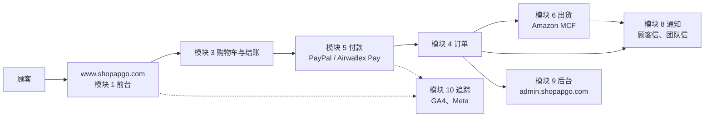

# 美国网站：各模块做了什么（上线时的状态）

| 项目 | 内容 |
|---|---|
| 日期 | 2026-10-16（www.shopapgo.com 切换上线当天） |
| 用途 | 一个模块一页：做了什么、怎么确认过、现在的状态、还缺什么。给你和同事快速了解整个系统 |
| 跟其他文件的关系 | 同一个资料夹里的 `M1-…md` 到 `M12-…md` 是**设计规格**（当初决定要做什么，最后更新 10/12）；这份是**实际做出来的结果**。待办和决定以 `docs/commerce-plan.md` 为准（§8.1 缺项总表、§9 验收表 G1–G15、纪录）；日常操作看 `docs/ops/runbook.md` |
| 注意编号 | 这里的「模块 1–12」是系统的 12 个部分；计划里的 M1–M20 是「切换前还缺的东西」清单，两套编号不同 |

---

## 全貌

- 网站和后台都跑在 Cloudflare（Worker `apgo-us-store`、数据库 D1），程序在 GitHub `WADEYEH/shopapgo`（模块 12）。
- 测试站 `staging.shopapgo.com` 跟正式环境用同一套程序，接付款服务的沙盒和模拟 Amazon，所有流程都先在这里演练过两轮。
- 自动测试：网站 33 项、商店程序 442 项，加上浏览器测试。每个 PR 都要全部通过才合并。

---

## 模块 1：前台页面与内容

**做了什么**
- 品牌页、指南、商品页、购物车、结账、四份政策页、联络页，全部合成**一个网站** www.shopapgo.com（D37、D41）。
- 旧网址都会自动转过来：`store.shopapgo.com`、`shopapgo.com` 的网页 301 到 www 的同一页；旧商品网址（例如 `/products/d204`）一次就转到新网址（D39）。
- 找不到的页面有自己的 404 页；有网站地图、商品的结构化资料。
- 页尾和联络页显示卖家：瑋瑄科技（WEI SYUAN TECHNOLOGY CO., LTD.，统编 94071421）。

- 商品页、政策页、联络页开放给 Google，列在网站地图（37 页）；商品资料包含价格、有货、运费、送达天数、退货（D71）。

**怎么确认过**：画面检查 14 页 × 4 种宽度（手机 320／390、平板、桌面）没有破版或坏图（G13）；切换后逐项检查网址和转址（营运手册第 24 节）；Rich Results Test 产品摘要、商家信息都有效（G10）。

**现在**：✅ 上线。

## 模块 2：商品与价格

**做了什么**
- 两个商品：Atomic Colored Glaze（D204）**$59.99**、Atomic Glaze Coating（D215）**$29.99**。
- 运费每单 **$7.99**（标准配送，3–5 个工作天）；只送美国 48 州和 DC。
- 销售税先 **$0**（D68），之后每季检视（C13）。
- 价格只有一个来源：服务器每次重新计算，浏览器传来的价格一律不采用。
- 拥有者可以在后台改商品名称、价格、图片，或暂停销售，发布后网站马上更新（D52）。

**怎么确认过**：测试站 8 张单的金额，在购物车、结账、订单、后台、付款服务都一致（G2）；10/16 你确认价格。

**现在**：✅ 上线。
**还缺**：组合包（等你决定内容，O9）。库存显示和缺货停止结账在 C4 完成（10/18）。

## 模块 3：购物车与结账

**做了什么**
- 购物车存在浏览器，每项最多 10 件。
- 结账三步：联络方式 → 收件地址 → 付款。
- 地址规则：不收 AK、HI、领地、邮政信箱、军邮；用 Google 地址验证，缺门牌或公寓号会提醒顾客。
- 还没付款的结账**不是订单**（D36）：24 小时后失效，30 天后删除个人资料；后台「未完成结账」看得到。
- 结账资料会暂存，顾客重新整理页面不用重填。

**怎么确认过**：演练第二轮第 1–3 项；G3（地址规则）。

**现在**：✅ 上线。

## 模块 4：订单核心

**做了什么**
- **付款成功才成立订单**（D36）；同一次结账就算开两个分页都按付款，也只收一次钱。
- 付款后 **1 小时**内可以取消或改地址（D23），之后才送 Amazon。
- 订单状态只能照规则走（例如已出货不能取消）；不合规则的操作会被拒绝并通知团队。

**怎么确认过**：演练（两个分页只扣一次款、改地址、取消、调时间测失效与清资料、拒绝不合理的操作）。

**现在**：✅ 上线。

## 模块 5：付款

**做了什么**
- **PayPal**（正式）：有 PayPal 帐户的顾客用帐户付；没有帐户的可以在 PayPal 视窗刷卡（Debit or Credit Card）。
- **Airwallex Pay**（正式，你选直接显示）。
- **Airwallex 信用卡、Apple Pay、Google Pay**：程序都做好了，但正式帐户还没开通信用卡（M18），所以用开关先关掉（D70）；开通后打开开关就好（C14）。
- 付款服务的通知（webhook）都会验证签名；同一个通知重复来只记一次。
  - Airwallex：`https://www.shopapgo.com/api/webhooks/airwallex`，版本 2026-08-21。
  - PayPal：`https://www.shopapgo.com/api/webhooks/paypal`。
- PayPal 只有真的放行才算付款；还在待处理时不成立订单、不出货，顾客页面显示「付款确认中」，你会收到写明原因的通知（D72）。PayPal 载入失败时显示讯息和「Try again」（D74）。
- 付款失败会显示清楚的讯息，可以在同一页换方式重试（G4）。
- 退款从后台按，Airwallex 或 PayPal 都会处理；拒付会记录、冻结订单、通知你，可以一键汇出拒付佐证。
- 后台「付款查询」可以直接向付款服务查一笔付款的状态（只读）。

**怎么确认过**：测试站沙盒 8 张单（卡 6、PayPal 2），包括退款和拒付。正式环境 10/16：PayPal 用正式金钥建单成功、读单成功（没有付款）。

**现在**：✅ 上线（PayPal、Airwallex Pay）。
**还缺**：第一张真实付款（C15）；Airwallex 信用卡开通（M18 → C14）。

## 模块 6：出货（Amazon MCF）

**做了什么**
- 订单付款满 1 小时后**自动送 Amazon 出货**，送出后马上读回 Amazon 的资料，比对商品、数量、地址。
- 排程每 5 分钟读回出货状态和追踪号，自动寄出货信；Amazon 分好几箱寄时，每个追踪号都列出。
- Amazon 缺货：通知你、寄延迟信给顾客、每天自动重送、第 3 天再提醒；后台可以「取消并退款」。
- 送出满 2 个工作天没有追踪号、包裹被退回寄件人：都会通知你。
- 拥有者专用的「Amazon 测试单（不出货）」：建一张 Hold 单、读回比对、取消。
- 测试站接的是模拟 Amazon，不会真的出货。

**怎么确认过**：演练（送单、读回比对、缺货、送单失败）。正式环境 10/16：连线检查正常；测试单第一次取消时 Amazon 回「忙」，修正后（#74）第二次三步都通过（G15）。

**现在**：✅ 上线，自动送单已开启。
**还缺**：第一张真实订单整段跑过（C15）。库存每 15 分钟读一次，少于 5 件自动缺货（C4，营运手册第 26 节）。

## 模块 7：售后

**做了什么**
- 退货政策：送达 30 天内、未开封可退；改变心意由顾客付运费；瑕疵、损坏、寄错由我们负责（D13、D18、D27–D30）。
- 退货寄回 Amazon 仓库，由客服处理（D24）。
- 后台可以退款、取消、汇出拒付佐证。只取消（不退款）时，顾客的信写「我们会尽快退款」，后台首页和每日摘要会提醒还没退的单（D73）。

**现在**：✅ 先用人工流程上线。
**还缺**：售后案件系统（切换后再做，计划第 5 章）。

## 模块 8：通知

**做了什么**
- 寄信用 Resend，寄件人 `orders@shopapgo.com`（SPF、DKIM、DMARC 都通过，C5）。
- 顾客会收到：订单确认、出货、延迟、取消、退款等信（英文）；同一种信每张订单只寄一次，寄失败会自动重试。
- 团队（wadeyeh@apgo.com.tw）会收到：新订单、送单失败、缺货、拒付、退款失败、设定被改动等通知，以及每日摘要。
- 寄送状态由 Resend 通知回来，后台订单页看得到每封信。
- 联络表单的留言寄到客服信箱，有 Cloudflare 的机器人检查（Turnstile）。

**怎么确认过**：测试站所有信件都实际寄送过；正式环境 10/16 联络表单寄出成功。

**现在**：✅ 上线。

## 模块 9：后台

**做了什么**
- 独立网址 **admin.shopapgo.com**（跟商店分开，比较安全；`www.shopapgo.com/admin` 故意显示找不到页面）。
- 中文／英文切换；成员和权限（拥有者、成员）；每个操作都记下是谁做的。
- 首页：今天与本月营收、需要处理的事、出货进度、系统状态（各服务的连线）。
- 订单、未完成结账、商品与库存、顾客（汇出或删除个人资料）、客户留言、报表、操作纪录、成员、Amazon 工具。

**怎么确认过**：演练全程用后台操作；正式环境 10/16 用后台做 Amazon 测试单、付款查询、查看留言。

**现在**：✅ 上线（登录用 email ＋ 密码）。
**还缺**：正式后台加 Cloudflare 登录保护（测试站已经有，正式环境切换后再做，M4）。

## 模块 10：追踪与分析

**做了什么**
- Google 代码管理工具 GTM-TD5NTFH9（第 3 版，含 GA4 电商事件）→ GA4 资源「shopapgo.com (US)」。
- Meta Pixel（浏览器）＋ Conversions API（服务器），购买事件两边用同一个编号去重。
- 尊重浏览器的「不追踪」讯号（GPC，D46）。
- 退款会通知 GA4，从营收扣掉（10/16 设好密钥）。

**怎么确认过**：10/16：GA4 即时报表收到 www 的访客；Meta 收到 www 的浏览器事件；Meta 的测试事件代码已删除，之后的购买会正常计入。

**现在**：✅ 上线。
**还缺**：第一张真实订单时确认 Meta 的 Purchase（浏览器＋服务器、去重）和 GA4 的 purchase（G9、C15）。

## 模块 11：法规与政策

**做了什么**
- 四份政策（隐私权、销售条款、退货退款、运费），10/16 生效。你决定不请律师，用常见做法补齐（D69）。
- 卖家：瑋瑄科技（D66）；加州隐私法不适用，维持尊重 GPC（D67）；销售税先 $0（D68）。
- 政策里的数字（运费、送达天数、退货期限）跟结账规则自动比对，不会对不上。

**现在**：✅ 上线。
**还缺**：营业额变大后，建议请专业人士再看一次（`docs/legal/README.md` 有问题清单）；每季检视销售税（C13）。

## 模块 12：平台与安全

**做了什么**
- 部署：合并到 `main` 自动部署测试站（只部署最新版本，#70）；正式环境只能从 GitHub 手动部署，要打开开关 `PRODUCTION_DEPLOY_ENABLED`，还要 anpuuuuu 核准（D65）。
- 金钥都存在 Cloudflare，程序和文件里没有；设定被人在后台改动会寄信通知你。
- 监控：healthchecks.io 每 5 分钟收到一次排程回报，停了会寄信给你；`/api/health` 可以随时查看状态。
- 回退：两步指令写在营运手册第 24 节（Worker 回到切换前的版本 `f62194a4` ＋ `npm run rollback:routes` 把网址设定换回去）。
- 限速（防止有人狂按结账或联络表单）、测试站有密码和 Cloudflare 登录保护。

**怎么确认过**：演练、每次部署后检查；10/16 切换当天三次正式部署都成功。

**现在**：✅ 上线。
**还缺**：WADEYEH 也能核准正式部署（C16）。

---

## 上线后要做的事（摘要）

| 项目 | 什么时候 | 计划编号 |
|---|---|---|
| 第一张真实订单整段检查（付款、寄信、送 Amazon、出货、Meta／GA4） | 第一张订单进来时 | C15 |
| Airwallex 信用卡开通后打开刷卡、Apple Pay、Google Pay | Airwallex 通知后 | M18、C14 |
| **正式后台安全：Cloudflare 登录保护、换金钥、限速（检查报告的高风险）** | 尽快 | M4、C17 |
| 售后人工流程写进营运手册 | 上线后 | C18 |
| 检查报告的其他中、低风险项目 | 上线后 | C19–C25 |
| WADEYEH 也能核准正式部署 | 有空时 | C16 |
| 销售税检视 | 每季 | C13 |
| DMARC 改成拒收冒名信 | 上线稳定约一个月后 | C7 |
