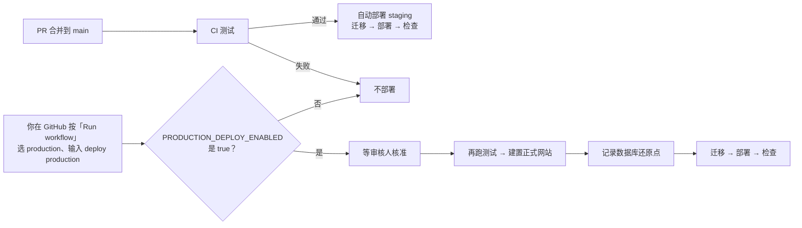

# 营运手册：部署、回退、还原、告警

| 项目 | 内容 |
|---|---|
| 范围 | 商店 Worker（`commerce/`）和它的数据库（D1）：staging 与正式环境 |
| 来源 | 阶段 3 计划 PR 3-1（`docs/design/phase3-plan.md` 4.1）；规格 M12 |
| 规则 | 只写名称，**不写任何密钥的值**。正式环境的设定有变动，同时更新 `docs/ops/production-config.md` |

---

## 1. 一页总览

| 要做的事 | 怎么做 | 谁 | 多久 |
|---|---|---|---|
| 部署 staging | `main` 更新、CI 通过后自动部署（第 3 节）；也可以在 GitHub 手动执行 | 自动 | 约 5 分钟 |
| 部署正式环境 | 只能在 GitHub 手动执行「Deploy」，并由审核人按核准（第 4 节）。**本机不部署正式环境** | 你核准 | 约 10 分钟 |
| 新版出问题，退回上一版 | `wrangler rollback`（第 5 节） | 工程 | 目标 10 分钟内 |
| 资料被改坏或误删 | D1 Time Travel 还原到指定时间（第 6 节） | 工程，你同意后 | 约 5 分钟，加上补资料的时间 |
| 新增数据库变更 | 新增一个编号迁移档，只增不改（第 7 节） | 工程 | — |
| 网站出错 | Workers Issues 收集错误（第 8 节） | 自动 | — |
| 排程停了 | 健康检查服务没收到心跳就寄信（第 9 节） | 自动 | 最慢 15 分钟内 |
| 加人、移除后台成员 | 后台「成员（Members）」（拥有者）；打开 Cloudflare Access 的步骤见第 11 节 | 拥有者 | 1 分钟 |
| 商品马上下架 | 后台「商品与库存」→ 商品页 →「停售这个商品」（拥有者，第 17 节） | 拥有者 | 1 分钟 |



---

## 2. 一次性设定（你要做的）

这些都在网页上操作，不需要指令。设定完告诉我，我帮你检查。

**10/15 进度**：第 1–3 项完成（金钥 `github-deploy-shopapgo`；GitHub 的 Production 环境原本是 Vercel 建的，补上核准人 anpuuuuu 和只允许 `main`，D65）；用新金钥从 GitHub 部署测试站成功。第 4 项照计划切换当天才设。

**谁能做**：第 2–5 项要 GitHub repo 拥有者帐号（WADEYEH）的管理权限，这台电脑登录的 GitHub 帐号（anpuuuuu）只有推送权限，不能改设定；第 1、6、8 项要能登录 Cloudflare 后台（帐号 wadeyeh@apgo.com.tw 的 Cloudflare）；第 9、10 项要能登录 Airwallex 和 PayPal 后台。权限还没拿到之前：staging 照旧从这台电脑部署，阶段 3 开发不受影响；**切换上线前一定要完成**，否则正式环境无法部署（依规则不从本机部署）。

| # | 在哪里 | 做什么 | 什么时候 |
|---|---|---|---|
| 1 | Cloudflare → My Profile → API Tokens → Create Token | 用「Edit Cloudflare Workers」范本，再加一项权限 **Account → D1 → Edit**；Account Resources 只选公司的帐号；名称例如 `github-deploy-shopapgo` | 现在 |
| 2 | GitHub → shopapgo → Settings → Secrets and variables → Actions → **Secrets** | 新增 `CLOUDFLARE_API_TOKEN`（上一步的金钥）和 `CLOUDFLARE_ACCOUNT_ID`（Cloudflare 首页右侧的 Account ID） | 现在 |
| 3 | GitHub → Settings → Environments → New environment | 名称 `production`；勾 **Required reviewers**，加你自己；Deployment branches 选 **Selected branches**，只加 `main` | 现在 |
| 4 | GitHub → Settings → Secrets and variables → Actions → **Variables** | `PRODUCTION_DEPLOY_ENABLED` 先**不要建**（或设 `false`）；切换上线那天才设 `true` | 切换时 |
| 5 | 同上 Variables | `APGO_US_ANALYTICS_READY`、`APGO_US_GTM_ID`、`APGO_US_META_PIXEL_ID`：正式网站的追踪设定（公开值，D40） | PR 3-9 时一起设 |
| 6 | healthchecks.io（免费方案即可；10/15 完成：帐号 dev01@apgo.com.my，检查「shopapgo production」「shopapgo staging」，第 7 步的 Ping URL 两个环境都设了）| 新增一个 check：Period 5 分钟、Grace 10 分钟，通知方式选你的 email；复制它的 Ping URL | 切换前 |
| 7 | 终端机（我可以帮你打指令，值由你贴上） | `npx wrangler secret put HEALTHCHECK_PING_URL --env production`，贴上第 6 步的 Ping URL。staging 要不要也设一个可以自己决定 | 切换前 |
| 8 | Cloudflare → Workers & Pages → `apgo-us-store` → Issues | 部署后自动开启，可以看到所有错误。要「主动通知」：Issues 的自动通知目前只能送到聊天工具或 webhook，不能直接寄 email；PR 3-7（团队通知）会加一个接收端，收到就寄团队信 | PR 3-7 |
| 9 | Airwallex 后台 → Developer → Webhooks | 正式与 staging 各一个通知网址，订阅第 14 节表格里的 Airwallex 事件（加上退款和争议）。10/14：staging 21 个事件；正式已订阅全部事件，切换当天把网址改成 www、版本改成 2026-08-21 | 切换前 |
| 10 | PayPal Developer → Apps & Credentials → 正式（Live）的 App → Webhooks | 新增通知网址，订阅第 14 节表格里的 8 个 PayPal 事件；把产生的 Webhook ID 用 `npx wrangler secret put PAYPAL_WEBHOOK_ID --env production` 设进去（值由你贴上）。staging 用 Sandbox 的 App 做一次。10/14 两边都做好了：正式是公司帐号的 `MyApp_Wix_com_Ltd`，staging 是同一帐号 Sandbox 的「Default Application」 | 切换前 |

金钥第 1 步的权限说明：「Edit Cloudflare Workers」范本可以部署 Worker、改路由；加上 D1 Edit 才能套用数据库迁移和查还原点。这个金钥只放在 GitHub 的 Secrets，不会出现在任何档案或纪录里。

没有设定第 1、2 步之前，CI 通过后的「Deploy」只会显示一行提示「没有设定金钥，所以没有部署」，不会失败也不会部署。

---

## 3. 部署 staging

**自动**：PR 合并到 `main` → CI 全部通过 → 「Deploy」工作自动部署**CI 测过的那个版本**：

1. 建置网站（测试设定：不载入任何追踪）
2. `wrangler d1 migrations apply DB --env staging --remote`：只套用还没套用过的迁移档
3. `wrangler deploy --env staging`
4. 检查 `https://staging.shopapgo.com/robots.txt` 有回应

**手动**：GitHub → Actions → Deploy → Run workflow → target 选 `staging`。

**从本机**（开发中测试用，staging 才可以）：

```bash
npm --prefix commerce run deploy:staging
```

staging 的特别设定：订单付款后会自动送到**假的 Amazon**（第 10 节），不会真的出货；顾客信只寄给白名单里的测试信箱。

---

## 4. 部署正式环境

**切换上线前不会执行**：`PRODUCTION_DEPLOY_ENABLED` 不是 `true` 时，这个工作直接跳过。

1. GitHub → Actions → Deploy → Run workflow，branch 选 `main`，target 选 `production`，confirm 输入 `deploy production`。
2. 审核人（你）收到 GitHub 通知，看过后按 **Approve and deploy**。
3. 工作依序执行，任何一步失败都会停下，后面的不会做：
   1. 商店和网站的测试
   2. 建置正式网站（`build-site.mjs --production`：追踪设定必须由 GitHub Variables 明确给值，开了追踪就要是正确的 GTM 和 Pixel ID，否则拒绝建置）
   3. 检查 Worker 能打包
   4. **记录数据库还原点**：`wrangler d1 time-travel info DB --env production --json`，结果写在这次执行的 Summary 页
   5. 套用迁移档
   6. 部署
   7. 检查 `https://www.shopapgo.com/api/store/config` 有回应
4. 部署后 30 分钟内看：Issues 有没有新错误、`/api/health` 是否 200、下一张订单是否正常。有问题照第 5 节回退。

---

## 5. 回退 Worker（新版出问题）

目标：**10 分钟内**回到上一版（M12-04、上线验收 G14）。回退只换程式，不动数据库；因为迁移只增不改（第 7 节），旧版程式在新的数据库结构上照样能跑。

1. 查版本（最新的在最上面）：
   ```bash
   cd commerce
   npx wrangler deployments list --env production
   ```
2. 退回上一版（不写版本号就是上一版；写版本号就退到那一版）：
   ```bash
   npx wrangler rollback --env production --message "回退：<原因>"
   npx wrangler rollback <版本号> --env production --message "回退：<原因>"
   ```
   加了 `--message` 就不会再问确认，按下去立刻生效。
3. 检查：`/api/store/config` 有回应、首页和结账页打得开、Issues 的错误停止增加。
4. 修好后照第 4 节重新部署（不要再 rollback 回新版，让 CI 部署修正后的版本）。

也可以在 Cloudflare 后台操作：Workers & Pages → `apgo-us-store` → Deployments → 版本右边的「⋯」→ Rollback。

**演练纪录（staging）**：见第 22 节。

---

## 6. 还原数据库（Time Travel）

D1 会自动保留过去每一分钟的状态（Workers 付费方案 **30 天**，免费方案 7 天），可以把整个数据库还原到这段时间里的任何一个时间点（M12-05、情境 J3）。

**注意：还原会把那个时间点之后的所有写入都拿掉**（包括之后的新订单、付款纪录）。正式环境还原前一定要：先跟你确认、先暂停会写入的东西、记下还原后要补回的资料。

1. 找时间点：出事前的时间（UTC），或部署时记在 Summary 页的还原点（bookmark）。
   ```bash
   cd commerce
   npx wrangler d1 time-travel info DB --env production --timestamp 2026-10-20T03:15:00Z
   ```
2. 先记下「现在」的还原点，万一还原错了可以再还原回来：
   ```bash
   npx wrangler d1 time-travel info DB --env production --json
   ```
3. 还原（指令会再问一次确认）：
   ```bash
   npx wrangler d1 time-travel restore DB --env production --bookmark <还原点>
   ```
   或用时间：`--timestamp 2026-10-20T03:15:00Z`。
4. 检查：订单数、最近几张订单的状态（只读查询）；`/api/health`。
5. 补回还原点之后发生、但应该保留的资料（例如付款服务那边成功的付款：付款服务会重送通知，或从后台付款查询补登）。

**演练纪录（staging）**：见第 22 节。

---

## 7. 数据库迁移（只增不改，D45）

- 迁移档放在 `commerce/migrations/`，档名 `0003_说明.sql`，编号连续。wrangler 在数据库里记录套用过哪些档（`d1_migrations` 资料表），每个档只套用一次。
- **只增不改**：可以新增资料表、索引、栏位；不删除、不改名、不改型别、不改既有资料。新栏位如果是 NOT NULL 一定要有预设值。
  - 理由：部署时会有一小段时间新旧两版程式同时在跑；回退时旧程式要能用新结构。只增不改，两边都不会坏。
- CI 自动检查（`commerce/tests/schema.test.mjs`）：每个档都符合规则；套用在正式数据库的实际结构上，原有栏位一个都没变。
- 真的需要删除或改名时：先用一个版本停止使用旧的，过一段时间确认没问题，再另外规划，并更新本节。
- 本机：`npm --prefix commerce run db:migrate:local`。staging：部署时自动。正式：只由 Deploy 工作套用。

| 档案 | 内容 |
|---|---|
| `0001_baseline.sql` | 原本 `worker/schema.sql` 的全部内容（建立所有既有资料表，已存在就不动） |
| `0002_operations.sql` | `cron_runs`（排程执行纪录，健康检查用）、`staging_fake_mcf_orders`（staging 假 Amazon 的订单） |

---

## 8. 错误告警（Workers Issues）

- `wrangler.toml` 三个环境都开了 `[observability.issues]`：未处理的错误、5xx 回应、错误等级的纪录都会被收集、分组。
- 看错误：Cloudflare → Workers & Pages → `apgo-us-store`（或 `-staging`）→ Issues。每个错误有发生次数、哪个版本、相关纪录。
- 主动通知：见第 2 节第 8 项（PR 3-7）。

---

## 9. 排程与健康检查

- 排程：正式环境**每 5 分钟**、staging 每 2 分钟。每次执行这些工作：结账失效与 30 天删除（`checkouts`，第 13 节）、争议期限提醒与每日对帐（`payments`，第 14 节）、缺货重送与出货提醒（`fulfillment`，第 15 节）、每日摘要（`digest`，第 16 节）、冷静期后送 Amazon（`mcf_submit`）、Amazon 出货状态同步（`mcf_sync`）、顾客信重寄（`email_retry`）、Meta 事件重送（`meta_retry`）。一件失败不影响其他件。
- 每次执行写进 `cron_runs` 资料表（`_tick` 代表整次执行），记录开始、结束、最后成功时间和最后的错误。
- `GET /api/health`：
  - 200 `{"ok":true,...}`：30 分钟内有执行完的排程
  - 503 `{"ok":false,...}`：超过 30 分钟没执行（或从来没执行过，例如刚部署好几分钟内）
  - 不含任何个人资料或错误内容，可以给监控服务检查。staging 在 Basic 登录后面。
- 心跳：设了 `HEALTHCHECK_PING_URL`（只接受 https）就每次执行完 ping 一次；有工作失败时 ping `…/fail`。healthchecks.io 在超过 Period + Grace 没收到心跳、或收到 fail 时寄信给你。

---

## 10. staging 的假 Amazon

Amazon 出货服务没有测试环境，staging 的订单如果真的送出去会真的出货。所以 staging 设了 `MCF_FAKE = "true"`：所有出货相关的呼叫都由 Worker 里的假服务回答（`commerce/worker/fake-amazon.js`），**完全不连到 Amazon**，资料存在 staging 数据库的 `staging_fake_mcf_orders`。

| 想测试 | 怎么做 | 结果 |
|---|---|---|
| 正常出货 | staging 照常下单付款 | 收到订单 → 2 分钟后「处理中」→ 10 分钟后「已出货」，有 Amazon Logistics 追踪号（`TBA9` 开头）；下一次排程同步后订单标成已出货、寄出货信（只寄白名单信箱） |
| 缺货 | 收件人姓名里有 `STOCKOUT`（例如姓氏填 STOCKOUT） | 2 分钟后 Amazon 回报「无法出货」（UNFULFILLABLE），后台显示送单被拒 |
| 出货快一点 | staging 的设定加 `FAKE_MCF_SHIP_MINUTES = "1"` 后重新部署 | 1 分钟后出货 |

安全设计：`MCF_FAKE` 只有在 `SITE_ENV = "staging"` 时才有效；如果有人在正式环境或本机设了它，**所有送单都停止**（不会改送真的 Amazon），后台显示原因。CI 检查正式环境的设定里没有 `MCF_FAKE`。

---

## 11. 后台登录：成员名单与 Cloudflare Access（PR 3-2）

**现在的状态**：成员名单、成员页、全站操作纪录都已经在用；登录还是共用帐密（staging 另可用网站的 Basic 登录）。共用帐密登录的人算「拥有者」，操作纪录记在那组帐号的 email 下。第一位拥有者是 `ADMIN_OWNER_EMAIL`（wadeyeh@apgo.com.tw），第一次打开成员页时自动建立。

**规则**（M9 §1）：
- 拥有者：所有功能，加上管理成员；成员：日常操作，看不到成员页。
- 最后一位拥有者不能被移除，也不能改成成员。
- 每次加人、改角色、移除都写进操作纪录（谁、何时、改前改后、原因），并寄信给所有拥有者。
- 打开 Access 之后，后台每个请求都会重新查名单：移除的人下一个动作就进不来，不用等登录过期。

**打开 Cloudflare Access 登录**（你能登录 Cloudflare 后台时一起做，约 15 分钟；先做 staging，切换时再做正式环境）：

| # | 在哪里 | 做什么 |
|---|---|---|
| 1 | Cloudflare → Zero Trust（第一次进入会请你选 team 名称和方案） | team 名称例如 `apgo`，登录网址就是 `apgo.cloudflareaccess.com`；方案选 Free（50 人以内免费） |
| 2 | Zero Trust → Settings → Authentication | 登录方式加 Google；内建的「One-time PIN」（email 验证码）保留，给没有 Google 帐号的人用 |
| 3 | Zero Trust → Reusable components → Lists → Create list | 类型 **Emails**，名称 `apgo-backoffice-members`，先放 wadeyeh@apgo.com.tw。复制名单的 ID |
| 4 | Zero Trust → Access controls → Applications → Add → Self-hosted | 网域 `admin-staging.shopapgo.com`；Session 24 小时；Policy：Allow，Include「Emails in list」选第 3 步的名单。存好后复制 **Application Audience (AUD) Tag** |
| 5 | My Profile → API Tokens → Create Token → Custom | 只给「Zero Trust 名单编辑」一项权限（画面上的名称我会在旁边确认），只限公司帐号；名称例如 `backoffice-member-list` |
| 6 | 终端机（我打指令，金钥由你贴上） | `npx wrangler secret put ACCESS_LIST_API_TOKEN --env staging` |
| 7 | 我 | 在 `wrangler.toml` 的 staging 设定加 `ADMIN_ACCESS = "true"`、`ACCESS_TEAM_DOMAIN`、`ACCESS_AUD`、`CLOUDFLARE_ACCOUNT_ID`、`ACCESS_LIST_ID`（都不是密钥），部署 staging |
| 8 | 你和一位同事 | 你用 Google 登录 admin-staging，应该看得到成员页；同事（还不在名单）应该被挡下；你在成员页加他，他再试应该进得来；移除后他下一个动作就被挡下 |

打开之后，共用帐密和 staging 的网站登录都不再能进后台；`ADMIN_TOKEN` 只给脚本用（角色是成员，不能管理成员）。

**10/15 测试站进度**：第 1、2 步原本就有（team `apgo`，`apgo.cloudflareaccess.com`；登录方式 Google 和 One-time PIN 都已开）。第 3 步名单 `apgo-backoffice-members`（ID `86679123-d156-420e-ad3b-66075645d1ee`）；第 4 步应用「shopapgo back office (staging)」（`admin-staging.shopapgo.com`，24 小时，规则「shopapgo back office members」= Allow、Email List 是这份名单）；第 5 步金钥 `backoffice-member-list`（Cloudflare 没有只能改名单的权限，最小是 Zero Trust: Edit，只限公司帐号）；第 6 步你在终端机贴上；第 7 步设定写进 `commerce/wrangler.toml`。帐号里另有 5 个其他系统的 Access 应用，都没有动。

**脚本怎么过 Cloudflare 那一关**：应用一建好，没登录的请求在 Cloudflare 就被挡下，后台程序收不到，所以只带 `ADMIN_TOKEN` 的脚本也进不来。做法：在 Zero Trust 建一把服务金钥（Service Token），应用加一条 Service Auth 规则只认这把金钥；脚本同时带服务金钥的两个标头和 `ADMIN_TOKEN`。10/15 已建：服务金钥 `claude-ops-staging`（有效 1 年，2027-10 到期前要换），应用加第 2 条规则「claude check scripts (service token)」= Service Auth、Service Token 是这把。你把 Client ID 和 Client Secret 贴进这台电脑的 `commerce/.dev.vars.staging`（git 不追踪），检查：带服务金钥加 `ADMIN_TOKEN` 得到 200，只带 `ADMIN_TOKEN` 被 Cloudflare 转去登录（302）。注意：在应用里加规则后还要按应用页面最下面的 **Save** 才会生效。

**技术备注**：Cloudflare 有一个直接把登录身分交给 Worker 的功能（`ctx.access`），但它不支援同时提供网页档案的 Worker（我们就是），所以 Worker 自己验证 Access 送来的登录凭证：用 team 的公开金钥验签章，比对 AUD、发行者和有效时间。这是 Cloudflare 文件建议的标准做法。

**名单同步失败时**：成员页会显示「Cloudflare list not updated」和原因，按「Update Cloudflare list now」重试。就算同步失败，后台本身仍然只认名单上的人（移除的人一样进不来），只是 Cloudflare 那层可能还放他到登录画面。

---

## 12. 订单：冷静期、冻结、取消、改地址（PR 3-3）

**冷静期**：付款成功后先等 **1 小时**才送 Amazon（D23），这段时间顾客可以请客服取消或改地址，不用向 Amazon 取消。时间到了以后，排程（正式每 5 分钟、staging 每 2 分钟）把订单送出。后台订单页会写「Cooling-off until …」。

- 只有「付款时 Amazon 自动送单是打开的」订单会排进去。之前付款的、或付款时送单关着的订单，**永远不会被自动送出**，要人工处理（避免切换上线时把旧订单重复出货）。
- 时间到时如果送单被关掉或设定不完整，订单离开排程并寄信通知拥有者「没有送出，请人工处理」。
- 想改长短：设定 `ORDER_COOLING_OFF_MINUTES`（分钟，预设 60）。

**冻结**（不送 Amazon、不能出货）：需人工确认的订单、有任何没失败的退款（拒付在 PR 3-5 加入）。冻结原因显示在订单页。

**后台动作**（每个都要填原因，记在订单历史和 Activity）：

| 动作 | 什么时候可以 | 结果 |
|---|---|---|
| 确认（Confirm order） | 需人工确认的订单 | 变成已付款，寄确认信、通知、广告事件各一次，并开始冷静期 |
| 取消（Cancel order） | 需人工确认、已付款、或已送 Amazon 还没出货 | 已送 Amazon 的会先请 Amazon 取消，Amazon 同意才取消订单；不同意就维持原状并通知团队。取消后**退款要到 Airwallex 或 PayPal 后台操作**（D24），订单页会提示金额 |
| 改地址 | 已付款而且还在冷静期内 | 重新检查地址（同结账的规则和 Google 验证），记下改前改后。换到税率不同的州会被拒绝（金额不能变），请取消重下 |

已出货的订单不能取消，走退货。任何不合法的状态变更都会被拒绝、记录，并寄信通知拥有者。

**自动处理**：出货前收到全额退款，订单自动取消（已送 Amazon 的先请 Amazon 取消）；部分退款则冻结订单并通知拥有者一次。付款金额不符的订单进入「需人工确认」，并通知拥有者一次。

**顾客信**：取消确认信、改地址确认信在 PR 3-7 加入；在那之前，取消或改地址后请从客服信箱回覆顾客。

**地址验证的用量和费用**（M7，10/13）：Google Cloud 帐号 wadeyeh@apgo.com.tw 的专案 `shopapgo`，付款帐户 My Billing Account。结账的地址检查算「Address Validation Pro」：每月前 5,000 次免费，之后约每 1,000 次 US$17。配额设每天最多 150 次（一个月最多约 4,650 次，不会产生费用）。一张订单通常要 2–3 次（填地址时一次、付款前再一次，改地址再加）。超过当天上限时结账照常，只是地址记「未验证」，后台订单页看得到。每天订单常超过约 50 张时，到 Google Cloud → Google 地图平台 → 配额，把「ValidateAddressRequests per day」调高（会开始收费）。

---

## 13. 未完成结账（D36，PR 3-4）

**订单从付款成功开始**。还没付款的叫「未完成结账」：不在订单列表、计数和报表里，在后台「Unfinished checkouts」看。

- **一次购物一笔**：结账页记住结账编号（同一个浏览器的所有分页共用），重试、重新整理、开第二个分页、换付款方式都沿用同一笔，付款成功后它的编号就是订单编号。
- **只收一次钱**：每笔结账开过的每张付款单都记下来。金额变了会作废旧的卡片付款单；新的 PayPal 单会作废旧的 PayPal 单；付款成功后其他付款单全部作废；已付款或已失效的结账不会再向 PayPal 请款。万一还是两边都付成功，**后到的那笔自动全额退款**，并寄信通知拥有者（这是系统唯一会自己做的退款，其他退款照 D24 在付款服务后台做）。
- **24 小时失效**：排程先问付款服务。已经付款成功的变成订单；还在处理中的先不失效；其他的作废付款单、标为已失效。不寄信给顾客。失效后才付款成功的照样成立订单，并通知拥有者。
- **30 天删除个人资料**：未完成结账建立 30 天后，删除 email、姓名、地址、电话和广告追踪资料，只留品项、金额和州（统计用）。所有订单的广告 IP 和浏览器资讯也在 30 天后删除。
- **切换上线时**：正式数据库里 landing 时期留下的 39 笔待付款纪录，会在第一次排程时照上面的规则失效（先问 Airwallex、再作废付款单）。

**后台「Unfinished checkouts」**：依状态（进行中、已失效）筛选、用 email 搜寻；每笔显示品项、金额、建立时间和付款失败原因，用来回答顾客「我付不了款」。不会寄提醒信。

---

## 14. 付款事件与每日对帐（PR 3-5）

退款照 D24 一律在付款服务后台做（Airwallex 或 PayPal），我们的系统只负责记下来、冻结或取消订单、通知人。

**退款与款项撤回（两家同一套）**

| 发生的事 | 系统怎么做 |
|---|---|
| 未出货的订单被全额退款 | 订单自动取消（取消原因「全额退款」），退款信寄给顾客 |
| 未出货的订单被部分退款 | 订单冻结（不送 Amazon、不能手动出货），寄信通知拥有者；退款信寄给顾客 |
| 已出货的订单被退款 | 只记录，退款信寄给顾客 |
| PayPal 款项撤回（通常是争议后 PayPal 把钱拿回去） | 当成全额退款处理，另外寄信通知拥有者 |
| PayPal 拒绝一笔已付款订单的请款 | 寄信通知拥有者：钱没有进来，先不要出货，到 PayPal 后台查 |

PayPal 订单的后台「Refunds」区块没有「Sync refunds」按钮（那个按钮只查 Airwallex），PayPal 的退款由通知自动进来。

**拒付与争议（两家）**

- 顾客向银行或 PayPal 申请争议时：记下哪一家、原因、金额、回应期限；**未出货的订单冻结**；寄信给拥有者，含回应期限。
- **期限前 3 天**再寄一次提醒（每个争议一次）。
- 回应：到 Airwallex 或 PayPal 后台上传订单、付款、出货追踪资料（一键汇出在 PR 3-11）。
- **赢了**：解除冻结，冷静期过了就照常送 Amazon。**输了**：视同全额退款，未出货就取消订单（取消原因「拒付」）；已出货的只通知拥有者，由团队决定。
- 后台订单列表按「**争议（Disputes）**」只看争议中的订单，期限最早的排最前面；订单页的「付款」卡片里有「争议」区块。

**每日对帐（距离上次满 24 小时后的第一次排程执行时做）**

- 比对近 3 天：
  - 我们开过、还没记成已付款的付款单，再问一次付款服务。付款服务显示已付款的，**直接补成订单**（如果那笔结账已经付过，就当成重复付款自动退款）。这是「付款成功但我们当下漏掉通知」的情况。
  - 我们记为已付款的订单，向付款服务确认。付款服务没显示已付款的，**只通知、不自动改**：先不要出货，到付款服务后台查。
- 有发现就寄一封「Daily payment check」给拥有者，列出每一笔。付款服务暂时连不上的只计数，不寄信。
- 上次对帐时间记在 `ops_state` 的 `payments.reconciled_at`。

**通知要订阅的事件**（需要能登录 Airwallex、PayPal 后台；见第 2 节第 9、10 项）

| 付款服务 | 事件 | 通知网址 |
|---|---|---|
| Airwallex | `payment_intent.*`、`payment_attempt.*`（已有）、`refund.received`、`refund.accepted`、`refund.settled`、`refund.failed`、`payment_dispute.*`（全部争议事件） | `https://<网域>/api/webhooks/airwallex` |
| PayPal | `PAYMENT.CAPTURE.COMPLETED`、`CHECKOUT.ORDER.COMPLETED`、`PAYMENT.CAPTURE.REFUNDED`、`PAYMENT.CAPTURE.REVERSED`、`PAYMENT.CAPTURE.DENIED`、`CUSTOMER.DISPUTE.CREATED`、`CUSTOMER.DISPUTE.UPDATED`、`CUSTOMER.DISPUTE.RESOLVED` | `https://<网域>/api/webhooks/paypal` |

每个通知都先向付款服务查最新状态再处理，不是我们订单的付款一律略过；付款服务暂时连不上时回错误，让它稍后重送。

---

## 15. 出货：送单比对、缺货、Hold 测试单（PR 3-6）

**送单后比对**：每张订单送 Amazon 后，系统马上读回 Amazon 的版本，比对商品、数量和收件地址。
- 一致：订单页「Amazon MCF」区块显示「Amazon's copy: matches what was sent」。
- 不一致：寄信给拥有者，列出差在哪里。Amazon 还没开始拣货的话，在订单页按「**Cancel at Amazon**」（只停掉 Amazon 那一笔，订单维持已付款），检查订单后按「Retry send to Amazon」重送。
- 当下读不到：下次同步再比。

**Amazon 缺货（无法出货）**
1. 第一次发生：寄信给拥有者；寄一封延迟信给顾客（「暂时缺货，3 天内出不了货就取消并全额退款，不用做任何事」）。
2. 每天自动重送一次。补到货就照常出货、寄出货信。
3. 第 3 天还没出货：再提醒拥有者一次。
4. 决定取消：订单页「Amazon 出货」卡片按「**取消并退款（Cancel and refund）**」，确认后系统会先取消订单，再向 Airwallex 或 PayPal **全额退款**，退款信自动寄给顾客。按两次也只会退一次。退款失败时订单仍是已取消，可再按一次，或到付款服务后台退。顾客同意等的话就不用按。

**送出满 2 个工作日还没追踪号**：寄信给拥有者一次（周末不算），顾客不会收到信。到 Seller Central 的 Multi-Channel Fulfillment 订单查原因。

**Hold 测试单（切换当天，打开自动送单之前）**
1. 用拥有者帐号登录后台，到「订单」页最下方展开「**Amazon 工具**」，按「**Amazon 测试单（不出货）**」，确认。
2. 系统会：在 Amazon 建一张 **Hold**（保留不出货）的测试单（1 件、测试地址）→ 读回比对、确认真的是 Hold → 立刻取消。
3. 三步都显示 OK 才算通过，之后才把 `MCF_AUTO_SUBMIT` 打开。
4. 取消失败：会寄信给拥有者，请到 Seller Central 手动取消那张 `HOLDTEST-…` 单（Hold 单不会出货，但会占 1 件库存）。

**staging 的模拟 Amazon**：收件人姓名含 `STOCKOUT` 会变成缺货；含 `MISMATCH` 会让 Amazon 的版本多 1 件，用来试送单后比对；含 `REJECT` 会在送单时被拒收，用来试「送单失败」的团队通知（C10）；Hold 单永远不会出货。

**库存**：商品页缺货显示和后台库存数字，要等 Amazon 转接程序（`amazon-spapi-mcp`）开放一个只读的查库存入口，另开小 PR；在那之前后台显示「库存未连接」。

---

## 16. 通知：顾客信、团队信、每日摘要、寄件网域（PR 3-7）

**顾客会收到的信**（英文，每张订单同一种信只寄一次；后台订单页「Emails and history」看得到每封信的状态，可以重寄）

| 信 | 什么时候 |
|---|---|
| 订单确认 | 付款成功 |
| 出货通知 | 拿到追踪号 |
| 退款完成、退款失败 | 付款服务回报 |
| 缺货延迟（PR 3-6） | Amazon 第一次回报缺货 |
| 取消确认（新） | 已付款的订单被取消；拒付输掉的不寄（银行已经处理） |
| 改地址确认（新） | 冷静期内改了地址，信里是新地址 |
| 重复的付款已退回（新） | 同一笔结账第二次付款成功、系统自动退还 |

**团队信谁收**：每个人在后台左下角（自己的名字下方）按「**团队邮件：开 / 关**」自己开关。拥有者预设收，一般成员预设不收；最后一个收的人不能关。成员加入、移除、改角色的通知照样寄给所有拥有者。

**团队信有哪些**：需人工确认、重复付款已自动退还、结账失效后才付款、送单失败、Amazon 关单或缺货（第 3 天再提醒）、Amazon 的版本跟订单不一致、送出 2 个工作日没追踪号、拒付（开启、期限前 3 天、结果）、部分退款冻结出货、退款失败、PayPal 撤款或拒绝请款、每日对帐有发现、**地址没检查到**（新：结账当下地址检查服务连不上，出货前请看一下地址）、不合法的状态变更、Hold 测试单没取消成功、每日摘要。

**每日摘要**（新）：每天台湾时间早上 8 点后的第一次排程，寄一封「Daily summary」，列出还没处理的：需人工确认、没送到 Amazon、Amazon 缺货（第几天）、送出 2 个工作日没追踪号、进行中的拒付和期限、没成功的退款、前一天没送达的顾客信、前一天地址没检查到的订单。都没有就不寄。

**寄件网域改成 shopapgo.com**（10/11 已在 Resend 加入 shopapgo.com、区域 us-east-1，并在 Cloudflare 加好下面的纪录；以下是当时的步骤，换网域或重做时照做）
1. 登录 Resend → Domains → **Add domain**，输入 `shopapgo.com`。
2. 选「Manual setup」（不要用 Auto configure，那会让 Resend 取得 Cloudflare 的权限）。Resend 会列出 DNS 纪录：TXT `resend._domainkey`（DKIM）、CNAME `rsend` → `rsend.forge.rmta.net`、CNAME `send` → `send.forge.rmta.net`。到 Cloudflare → shopapgo.com → DNS → Records 照抄加入，CNAME 的 Proxy 要关闭（DNS only，灰色云）。
3. 加一笔 DMARC（Gmail、Yahoo 要求寄件网域要有）：Type `TXT`，Name `_dmarc`，Content `v=DMARC1; p=none;`（Resend 建议的值：先只观察、不拦信，确认都没问题再收紧）。如果已经有 `_dmarc` 纪录就不要重复加，告诉我。
4. 回 Resend 按 **Verify DNS Records**，几分钟内显示 Verified。之后把寄件人（`CUSTOMER_EMAIL_FROM`）改成 `APGO <orders@shopapgo.com>`：staging 已在 10/11 改好；正式环境 10/15 写进 `commerce/wrangler.toml`（连同回信地址、寄信重试、新订单通知和退款失败的收件人），切换那次部署时生效。不要在切换前把这些设到线上的旧店：旧店的顾客信会改用新订单通知的寄件人，开始寄信给真的顾客。回信地址维持 services@apgo.com.tw。
5. 确认：收到 shopapgo.com 寄出的信后，在 Gmail 打开「显示原始邮件」，SPF、DKIM、DMARC 都应显示 PASS（M8-09）。

---

## 17. 后台第一版（PR 3-8，D49、D50）

**语言**：预设中文。电脑版左下角、手机版右上角切换「中文 / EN」，记在这台浏览器（换电脑要再选一次）。顾客写的内容、名字、地址照原文显示。

**页面和网址**（可以加书签、贴给同事）：

| 页面 | 网址（admin.shopapgo.com/admin/ 后面） | 内容 |
|---|---|---|
| 首页 | `#/` | 今天营收、本月营收、平均客单价、本月退款；需要处理的事；出货进度；最新订单；系统状态；商品 |
| 订单 | `#/orders`（`?view=to_ship` 等） | 分类：全部、待出货、待审核、有问题、争议、已出货、已取消；付款状态和出货状态分两栏；可搜订单号、名字、Email、电话 |
| 订单页 | `#/orders/订单编号` | 进度、商品、付款与退款、争议、Amazon 出货、手动出货、时间线与内部备注、客户、地址、出货前检查。旧连结 `#订单编号` 会自动转过来 |
| 未完成结账 | `#/checkouts` | 见第 13 节 |
| 商品与库存 | `#/products`、`#/products/d204` | 价格、库存、本月销量、近 14 天每天件数、停售开关、变更记录 |
| 客户留言 | `#/messages` | 网站「联络我们」的留言 |
| 操作记录、成员 | `#/activity`、`#/members` | 成员页只有拥有者看得到 |

客户、报表、后台退款见第 19 节；后台改价格、文字、图片见第 23 节。

**首页的数字怎么算**：「今天」「本月」以台湾时间为准（`ADMIN_TIME_ZONE` 可改）。营收以**付款当天**计算，是订单总额（含运费和税），之后退款不扣；退款另外以付款服务**建立退款的日期**计算，失败的退款不算。未完成结账都不算。「需要处理」跟每日摘要是同一份清单（第 16 节）。

**内部备注**：订单页「时间线」上方写，所有成员都能写、都看得到，顾客看不到。会记下谁写、什么时候写；**不能修改或删除**，写错就再补一条。

**停售（拥有者）**：
1. 后台「商品与库存」→ 点商品 → 右边「网站销售」按「**停售这个商品**」。
2. 画面会说明结果，可以填原因（会记在操作记录），按「**确定停售**」。
3. 马上生效：商品页和商品总览不再有「加入购物车」，显示「暂停销售」；购物车里已有这个商品的客户会看到提示，移除后才能结账；结账、PayPal 都会拒绝。**已付款的订单照常出货。**
4. 要恢复：同一个地方按「**恢复销售**」。每次停售、恢复都记在操作记录和商品页的「变更记录」。

成员看得到商品是否在售，但看不到停售按钮。

**Amazon 工具**（原本在订单列表上方的三个按钮）：移到「订单」页最下方的「Amazon 工具」：检查 Amazon 连线、同步所有在 Amazon 的订单、Amazon 测试单（拥有者）。

---

## 18. 追踪：GA4、Meta Pixel、隐私讯号（PR 3-9，D40、D46）

**一套 GTM**：正式网站的建置默认载入 9 月建的 `GTM-TD5NTFH9`（GA4 `G-YM10YMKE30`，在 mkt@apgo.com.tw 底下，D40）。要换别的容器，才需要在 GitHub 设 repository variable `APGO_US_GTM_ID`。staging 和本机一律不载入。

**一份 Meta Pixel**：全站（品牌页加商店页）共用 `public/js/meta-pixel.js`，dataset `2606879866471418`，跟后端 Conversions API 同一个，购买事件靠同一个事件编号去重。只在 www.shopapgo.com、shopapgo.com、store.shopapgo.com 启动。

**网站送给 GTM 的电商事件**（GA4 建议的名称，都带 `ecommerce` 物件：币别、金额、商品；购买另带订单编号、运费、税）：

| 事件 | 时机 |
|---|---|
| `view_item` | 看商品页 |
| `select_item` | 品牌页的商品按钮 |
| `add_to_cart`、`remove_from_cart` | 加入、移除购物车 |
| `view_cart` | 看购物车 |
| `begin_checkout`、`add_shipping_info`、`add_payment_info` | 结账各步骤 |
| `purchase` | 付款成功 |

**GTM 容器要设好的（在 GTM 后台做，切换上线前确认一次）**。10/12 已照下面设好并发布版本 3「APGO US ecommerce (PR 3-9)」：新增触发条件「CE - ecommerce」和代码「GA4 - ecommerce」，删除 `amazon_referral_click` 的代码和触发条件；内部流量筛选器依你的决定维持「测试」。之后如果有人改了容器，用这份清单再核对一次：
1. 用 mkt@apgo.com.tw 登录 tagmanager.google.com，打开容器 `GTM-TD5NTFH9`。
2. 有一个 **Google 代码**（Google tag），ID 是 `G-YM10YMKE30`，触发条件是所有网页（Initialization – All Pages）。
3. 有一个 **GA4 事件**代码：事件名称填 `{{Event}}`；勾选「**传送电子商务资料**」，资料来源选 **Data Layer**；触发条件是「自订事件」，事件名称用规则运算式 `^(view_item|select_item|view_cart|add_to_cart|remove_from_cart|begin_checkout|add_shipping_info|add_payment_info|purchase)$`。
4. 如果容器里有以前的 `amazon_referral_click` 代码，可以删掉（网站已经不送这个事件）。
5. 按「预览」，开 www.shopapgo.com 看商品、加入购物车，确认事件和 `ecommerce` 都出现（验收 M10-01）；没问题再「提交」。
6. GA4 后台 → 资料串流 → 设定标记 → 确认「定义内部流量」和资料筛选器「Internal traffic」是**有效**（M10-06）。

**隐私讯号 GPC**（D46，律师意见出来前的暂定做法）：浏览器送出 Global Privacy Control 时，那个人的网页不载入 Meta Pixel、不写 `_fbc`；他结账的订单也不留广告资料、后端不送 Meta 事件（订单记在 `order_privacy`）。GA4 照常。要关掉这个做法：网站在 GitHub 设 `APGO_US_HONOR_GPC = false` 后重新部署，Worker 在 `wrangler.toml` 的正式环境加 `HONOR_GPC = "false"`；两边要一起改。

---

## 19. 客户、隐私请求、后台退款、报表（PR 3-10，D51、D53–D56）

**客户**（`#/customers`）：付过款的人都在这里，用 Email 区分（没有会员帐号）。可以搜姓名、Email、电话，依最近下单、订单数、消费或姓名排序。点进去是客户页：订单、收件地址、联络表单留言、内部备注、隐私请求。客户页的网址用他任何一张订单的编号，所以网址里不会有 Email。订单页右边「查看这位客户的所有订单」也会连过来。

**后台退款（只有拥有者）**：订单页「付款」卡片的「退款」区块 → 按「**退款**」。
1. 已出货或已取消的订单：可以全额或部分退款，最多退到还没退的金额。
2. 还没出货的订单：只能全额退款。「先取消订单，取消成功才退款」预设勾选：先取消（已送 Amazon 的先请 Amazon 停止），成功才退款。Amazon 停不下来时**不会退款**，画面会说明一般做法：等客户收到后退货（或拒收退回）再退款；商品便宜、不值得来回运费时，也可以取消勾选直接退款，让客户留着商品。
3. 选原因（只记在后台，客户看不到）、可以写备注。「寄退款通知给客户」可以取消：取消后这笔退款不寄任何退款信，一起取消订单时也不寄取消信。
4. 按「确认退款」。同一个面板按两次只会退一次。结果和这笔退款（金额、原因、谁、什么时候）显示在退款区块和操作纪录。退款失败时钱没有退出去，可以再按一次「退款」重试。
5. 有拒付处理中的订单不能退款（请在付款服务后台回应）。成员看不到退款按钮。

**隐私请求**（客户来信要求查看或删除自己的资料，E11）：
1. 打开客户页 → 「隐私请求」→「记录一个请求」：选「查看我的资料」或「删除我的资料」、收到的日期、负责的人（后台成员）。系统算出 45 天的回复期限；结案前，首页「需要处理」和每日团队邮件都会提醒。
2. 查看：按「**汇出客户资料**」下载资料档，用安全的方式寄给客户，寄完从电脑删除。回到客户页把请求「结案」（选「已汇出资料」）。
3. 删除：按「**删除客户资料**」。还有订单没出货或取消、有退款或拒付处理中、还有邮件在寄时，画面会列出原因，要先处理完。可以删时，输入客户的 Email 确认，按「永久删除」。删除后：订单金额、商品和寄送的州保留（报税、对帐）；Email、姓名、地址、电话、营销同意、广告资料、邮件副本、地址修改纪录、备注、联络表单留言都删掉或清空；删除类的请求自动结案。**无法复原。**
4. Amazon 和 Airwallex、PayPal 自己保存的纪录后台删不到；客户问起时，回信说明这几家各自的隐私政策。
5. 汇出、删除、记录、结案都记在操作纪录，只记订单编号，不记 Email。所有成员都能做（D54）。

**报表**（`#/reports`）：选期间（今天、近 7 天、近 30 天、本月、上个月、今年，或自订开始和结束）。日期以台湾时间为准（D56，`ADMIN_TIME_ZONE` 可改），算法跟首页一样：订单算在付款那天、以订单总额计；退款算在退款那天；失败的退款和未完成结账不算。画面有营收、退款、净额、订单数、客单价、金额明细（商品、运费、税）、每天营收、各商品、各付款方式，以及「运费 vs Amazon 出货费」：订单送到 Amazon 时会顺便读一次 Amazon 的出货费估算，之前的订单没有估算，不算进比较。

**CSV 汇出**（报表页右下，期间跟画面一样）：
- 订单 CSV：每张订单一行（付款时间、状态、客户、州、商品、金额、退款、净额、付款方式与编号、出货与追踪、Amazon 出货费估算）。
- 收款与退款 CSV：每笔收款、每笔退款一行；同一个结账被付两次、系统自动退回的那笔也列出。每月月初下载上个月的给会计，并跟 Airwallex、PayPal 后台的月报对一次总额（M9-06）。
- 用 Excel 打开没问题（中文和以 = 开头的内容都处理过）。下载会记在操作纪录。

**付款查询**（「未完成结账」页最下方）：客户说付不了款时，输入 Airwallex 付款编号（`int_` 开头）或 PayPal 订单编号，看状态和失败原因。只读，不显示卡号和付款人资料。

---

## 20. 包裹追踪、退回包裹、拒付佐证、GA4 退款（PR 3-11，D57、D58）

**多个包裹**：Amazon 分好几箱寄出时，每个追踪号都记在订单页「出货」卡片（包裹 1、包裹 2……），出货信也全部列出，并提醒客户可能不同天到。

**物流状态**：每个包裹每天查一次 Amazon 的物流状态，送达后或出货 30 天后停止。订单页显示最新状态和查询时间。

**包裹被退回寄件人**（退回中、已退回、无法投递、已退回 Amazon 仓库）：系统寄团队信一次，订单时间线记一笔，首页「需要处理」和每日团队邮件列出 14 天。处理方式：联络客户确认地址 → 包裹回到 Amazon 后，在订单页重新送单，或用「退款」退钱。

**拒付佐证**（有争议的订单）：
1. 订单页「付款」卡片的「争议」区块 → 按「**汇出拒付佐证**」，会下载一个网页档。
2. 用浏览器打开 → 列印 → 「另存为 PDF」。
3. 到 Airwallex 或 PayPal 的争议页面上传这个 PDF，再写一两句说明（例如「商品已于 10 月 4 日送达，追踪号见附件」）。
4. 内容是英文：订单、付款、地址检查结果、商品、出货与每个包裹的追踪和送达、寄给客户的信、客户留言、政策网址。**不含内部备注和员工名字**。每次汇出都记在订单时间线。

**GA4 退款事件**：退款被付款服务接受后，网站会自己通知 GA4 把这笔扣出营收（只在正式环境，而且要有 `GA4_API_SECRET`；测试站永远不送）。切换上线时建立（D58）：GA4 → 管理 → 资料串流 → shopapgo.com → Measurement Protocol API 密钥 → 建立（名称写 shopapgo-worker）→ 复制密钥值 → `wrangler secret put GA4_API_SECRET --env production`（你操作，值不要贴到任何地方）。没设之前的退款事件 7 天后放弃。

---

## 21. 密钥外泄与线上设定比对（J5、J6，D59、D60）

**线上设定比对**：网站每天一次，以及每次新版本上线后，把自己的设定跟 repo 的 `commerce/wrangler.toml` 比对：一般设定的值、必须有的密钥（只看有没有，不看值）、数据库和限速的绑定。不一样就寄团队信「Live settings differ from the repo」，写出哪一项、应该是什么、现在是什么。处理：故意改的，就把改动写进 `wrangler.toml`、经 PR 部署；不是故意的，重新部署一次就恢复。在 Cloudflare 后台「新增」的一般设定、排程和网域路由，网站本身看不到，靠「只从 CI 部署」管住。

正式环境必须有的密钥（10/12 起）还包括 Amazon 出货连线（`AMAZON_OUTBOUND_BASE_URL`、`OUTBOUND_INTERNAL_TOKEN`、`MCF_SKU_MAP_JSON`）、`RESEND_WEBHOOK_SECRET` 和 `GOOGLE_ADDRESS_VALIDATION_KEY`。目前的正式环境（landing 的店）还没有这些和 `RESEND_API_KEY`、`PAYPAL_WEBHOOK_ID`，切换时要设好，否则会收到提醒信（总表在 `docs/commerce-plan.md` 第 8.1 节）。

**密钥外泄的处理步骤**。通用顺序：先建新的 → 设到 Worker → 确认能用 → 停用旧的 → 在操作纪录和付款服务后台看有没有被盗用 → 记在下面的演练纪录或事故纪录。设定一律用 `wrangler secret put <名称> --env production`（测试站用 `--env staging`），值从剪贴簿贴进去，不贴到聊天、文件或 Git。

| 密钥 | 在哪里换 | 换完怎么确认 |
|---|---|---|
| `AIRWALLEX_CLIENT_ID`、`AIRWALLEX_API_KEY` | Airwallex 后台 → 开发者 → API 金钥：新增一组，设好后停用旧的（两个都要换） | 首页「系统状态」Airwallex 正常；付款查询查一笔 |
| `AIRWALLEX_WEBHOOK_SECRET` | Airwallex → Webhooks → 该网址 → 重新产生 | 下一笔付款或退款事件有进来（订单页付款纪录） |
| `PAYPAL_CLIENT_ID`、`PAYPAL_CLIENT_SECRET` | PayPal Developer → Apps & Credentials → 该 App → 重设 Secret | 付款查询查一笔 PayPal 订单 |
| `RESEND_API_KEY` | Resend → API Keys：新增（只给寄信权限），设好后删除旧的 | 订单页重寄一封信 |
| `RESEND_WEBHOOK_SECRET` | Resend → Webhooks → 重新产生 | 下一封信的送达状态有更新 |
| `META_CAPI_ACCESS_TOKEN` | Meta 事件管理工具 → 资料集 → 设定 → 产生存取权杖 | Meta「测试事件」看到事件 |
| `OUTBOUND_INTERNAL_TOKEN` | 自己产生一串随机字，依序设到 amazon-spapi-mcp（`wrangler secret put OUTBOUND_INTERNAL_TOKEN --name amazon-spapi-mcp`）、测试站、正式环境。10/13 查过：只有我们的商店（apgo-us-store、apgo-us-store-staging，以及已停用的 apgo-us-store-next）用这个密码；评论邀请排程走内部连结、MCP 网关用 `MCP_API_KEY`，都不受影响 | 用新密码呼叫 `https://amazon-mcp.apgo.tw/internal/outbound/orders` 得到 200，错的得到 401 |
| `ADMIN_TOKEN` | 自己产生一串随机字（例如 `node -e "console.log(require('crypto').randomBytes(32).toString('base64url'))"`，结果直接贴进 secret put，不显示在画面上更好） | 用新金钥呼叫 `/admin/api/me` 得到 200 |
| `ADMIN_LOGIN_PASSWORD` | 自己设一个新密码 | 用新密码登入后台 |
| `ACCESS_LIST_API_TOKEN`、Cloudflare 部署金钥 | Cloudflare → 我的个人资料 → API 权杖 → 轮换；部署金钥同时更新 GitHub 的 Secret | 成员页同步；下一次部署成功 |
| `GOOGLE_ADDRESS_VALIDATION_KEY` | Google Cloud（wadeyeh@apgo.com.tw）→ 专案 `shopapgo` → API 和服务 → 凭证：建新金钥，只允许 Address Validation API，设好后删除旧的 | 用公开地址呼叫测试站的 `/api/checkout/address` 得到 valid |
| `TURNSTILE_SECRET_KEY` | Cloudflare → Turnstile → 该网站 → 轮换密钥 | 联络表单送得出去 |
| `GA4_API_SECRET` | GA4 → 资料串流 → Measurement Protocol API 密钥：新增，设好后删除旧的 | GA4 即时报表看到下一笔退款 |
| `STAGING_BASIC_AUTH_*`（测试站） | 自己设新的帐号密码 | 用新的登入测试站 |

**先存好、之后才生效**：`npx wrangler versions secret put <名称> --env production` 会建一个带新金钥、但不部署的版本；下一次正式部署（`wrangler deploy` 或 GitHub 的 Deploy）会自动带上它（10/13 在测试站验证过）。要设一把「切换后才该生效」的金钥时用这个方法。直接用 `wrangler secret put` 则是马上生效（会以现在的程序重新部署一次）。

**演练纪录**：第 22 节（2026-10-12 J5、J6）。

---

## 22. 演练纪录

| 日期 | 演练 | 环境 | 结果 | 花费时间 |
|---|---|---|---|---|
| 2026-10-09 | 第一次套用迁移档（PR 3-1 部署） | staging | `0001_baseline.sql` 没有改动既有的资料表（订单 23 张不变），`0002_operations.sql` 新增两张表；`d1_migrations` 记录 2 笔 | 部署全程约 3 分钟 |
| 2026-10-09 | 还原数据库（第 6 节） | staging | 记下还原点 → 建一张标记资料表（写 1 笔）→ 还原到还原点 → 标记资料表消失；订单 23 张、迁移纪录 2 笔都不变。还原指令同时回传「还原前」的还原点，必要时可以再还原回去 | 还原指令 5 秒；含前后检查约 1 分钟 |
| 2026-10-09 | 回退 Worker（第 5 节） | staging | 新版 `98d0ccf5` 退回上一版 `ff98a90d`：`deployments status` 显示上一版、网站有回应；再回到新版。旧版程式在新的数据库结构上正常（只增不改） | 回退含检查 17 秒；回到新版 15 秒（目标 10 分钟内：通过） |
| 2026-10-09 | 排程纪录（第 9 节） | staging | 部署后第一次排程（UTC 08:38）三个工作都成功；`cron_runs` 记下整次执行（`_tick`）和各工作的开始、结束、成功时间 | — |
| 2026-10-12 | 线上设定比对（第 21 节，J6，Claude 操作，D60） | staging | PR 3-11 部署（版本 `6cee4ea6`）后第一次比对：没有差异。故意部署只改了 `CUSTOMER_EMAIL_POLICY_NOTE` 的版本（`5ab34e45`、`354cd8db`）：下一次排程就发现，产生团队通知「Live settings differ from the repo (staging)」，写出哪一项、应有和实际的值；再部署原设定（`f3c0bbdd`）恢复。**发现**：通知信没寄出，寄信服务回答「HTTP 403: This API key is not authorized to send emails from shopapgo.com」：测试站的 `RESEND_API_KEY` 只允许旧网域，10/11 改用 orders@shopapgo.com 寄信后，测试站的团队信和顾客信都寄不出去（10/12 的每日摘要也是）。要在 Resend 建一把可以用 shopapgo.com 寄信的金钥，设成测试站的 `RESEND_API_KEY`；正式环境切换时也要这样的金钥。之后团队通知失败时，纪录会写出原因 | 发现差异：部署后 2 分钟内 |
| 2026-10-12 | 换密钥（第 21 节，J5，Claude 操作，D60） | staging | `ADMIN_TOKEN` 换成在这台电脑产生的新值（没有显示在任何地方），用 `wrangler secret put` 设定；新值只存在这台电脑的 `commerce/.dev.vars.staging`（不进 Git，给测试脚本用）。确认：新金钥呼叫 `/admin/api/me` 得到 200，错的金钥得到 401 | 约 1 分钟 |
| 2026-10-12 | 回退 Worker（第 5 节；阶段 3 演练第 13 项，Claude 操作） | staging | 版本 `83fa2d6e`（PR 3-12）退回 `0a114912`（PR 3-11）：商店设定、商品页、`/api/health`、后台都正常，商品设定里没有 3-12 的新栏位（确认是旧版在跑），旧版在已套用迁移 0013 的数据库上照常运作；再回到 `83fa2d6e` | 回退含检查 10 秒；回到新版 16 秒（目标 10 分钟内：通过） |
| 2026-10-12 | 还原数据库（第 6 节；演练第 13 项，Claude 操作） | staging | 记下还原点 → 建标记资料表 `drill_marker_20261012`（写 1 笔）→ 还原到还原点 → 标记资料表消失；订单 23 张、迁移纪录 13 笔、商品内容 0 笔都不变；还原指令同时保留「还原前」的还原点 | 还原指令 6 秒 |
| 2026-10-12 | 报表对帐（第 19 节；演练第 14 项的只读部分，Claude 操作） | staging | 期间 9/1–10/12：报表营收 $394.74、退款 $49.80、净额 $344.94、12 张订单，跟数据库加总、订单 CSV（12 列，总额和退款相同）、收款与退款 CSV（16 列：收款 $394.74、退款 −$49.80）、客户名单（5 位客户、12 张订单、累计 $344.94）全部一致。个人资料只在程式里比对，没有显示 | — |
| 2026-10-13 | 换测试站的 Resend 金钥（第 21 节，M1） | staging | 你在 Resend 建 `shopapgo-staging-shopapgo.com`（Sending access，只限 shopapgo.com），在这台电脑的终端机用 `wrangler secret put RESEND_API_KEY --env staging` 自己贴上（值没有出现在任何地方）。测试：经你同意，从测试站联络表单送一则测试留言 → 系统纪录「sent」，Resend 显示 Delivered 到 wadeyeh@apgo.com.tw。旧金钥 `shopapgo-staging` 暂留 | 设定约 1 分钟；寄出到送达几秒 |
| 2026-10-13 | 设定地址验证（M7） | staging | Google Cloud（wadeyeh@apgo.com.tw）新专案 `shopapgo`，付款帐户 My Billing Account；开启 Address Validation API；配额「ValidateAddressRequests per day」从无限制改成 150；新金钥 `shopapgo-worker-address-validation`，只允许 Address Validation API（应用程式限制选「无」：Worker 没有固定 IP）。你在终端机用 `wrangler secret put GOOGLE_ADDRESS_VALIDATION_KEY --env staging` 自己贴上。测试（公开的商家地址）：正确地址 valid；邮递区号写错 → suggest，建议 94043-1351 | 设定约 15 分钟 |
| 2026-10-13 | 「先存好、切换时才生效」测试（第 21 节） | staging | 用 `wrangler versions secret put` 存一把测试用金钥 `ZZ_STAGED_TEST`（不部署），测试站仍跑原版本；接着正常部署一次，新版本带有这把金钥；之后删除 | 约 2 分钟 |
| 2026-10-13 | 正式环境设定 M7、M8、M9（你决定现在就生效） | production | 设之前确认正式环境「最新版本」就是线上版本（设金钥只会带上新值，不会换程序），并请帮手代理逐行看过旧程序会怎么用这些金钥。设了：`RESEND_API_KEY`、`RESEND_WEBHOOK_SECRET`、`GOOGLE_ADDRESS_VALIDATION_KEY`（跟测试站共用）、`OUTBOUND_INTERNAL_TOKEN`（新）、`AMAZON_OUTBOUND_BASE_URL`、`MCF_SKU_MAP_JSON`。金钥由你在终端机贴上，或在这台电脑产生直接交给 wrangler，都没有显示在任何地方。Amazon 连线：amazon-spapi-mcp 健康检查 200、新密码 200、错的 401 | 约 1 小时 |
| 2026-10-13 | 测试站 Airwallex 通知加事件（M6） | staging | Airwallex Sandbox → 开发者 → Webhooks → `https://staging.shopapgo.com/api/webhooks/airwallex`：退款 4 个原本已有，加上全部 9 个争议事件，共 21 个（储存时要你输入密码确认） | 约 5 分钟 |
| 2026-10-14 | 正式环境付款通知（M6） | production | Airwallex 正式：通知 `https://store.shopapgo.com/api/webhooks/airwallex` 已订阅全部 268 个事件，不用改。PayPal 正式：公司帐号（wadeyeh@apgo.com.tw）→ Apps & Credentials → Live → `MyApp_Wix_com_Ltd` → Add Webhook，网址 `https://www.shopapgo.com/api/webhooks/paypal`，勾第 14 节的 8 个事件（要先把每一组展开，收起来时勾不上），储存后把 Webhook ID 用 `wrangler secret put PAYPAL_WEBHOOK_ID --env production` 设进去（你决定现在就生效） | 约 15 分钟 |
| 2026-10-14 | 测试站 PayPal 通知（M6） | staging | 同一个帐号 → Sandbox → 「Default Application」（测试站用的 App）→ Add Webhook，网址 `https://staging.shopapgo.com/api/webhooks/paypal`，同样 8 个事件，Webhook ID 设成测试站的 `PAYPAL_WEBHOOK_ID`。检查：后台首页 7 个连线全部正常（PayPal 显示通知已设定）；没签名的假通知得到 400 | 约 10 分钟 |
| 2026-10-14 | 演练第二轮第 1–7 项 | staging | 8 张测试单（卡 6 张、PayPal 2 张）。只扣一次款（两个分页）、确认信、新订单通知、改地址重新验证、取消、自动送假 Amazon 与读回比对、出货信、Airwallex 与 PayPal 退款（冻结、通知、退款信）、拒付（Airwallex 模拟 API，期限 2 天 → 下一次排程寄提醒）全部照规格。发现 3 个问题，PR #57 修正 | 约 2.5 小时 |
| 2026-10-14 | 演练第二轮第 8 项（缺货） | staging | 订单 E（卡片、收件人含 STOCKOUT）冷静期结束后送假 Amazon，4 分钟后回报缺货：缺货延迟信送达、团队收到缺货通知；后台按「取消并退款」→ 订单取消、Airwallex 全额退款 $37.98、取消信和退款信送达。PayPal 单 D 原本要测缺货，因为收件人被换成付款人名字（C9）而变成出货 | 约 1.2 小时（含 1 小时冷静期） |
| 2026-10-14 | 部署 #57 到测试站 | staging | 自动部署因为 GitHub 没有部署金钥（M5）而跳过，从这台电脑 `npm run deploy:staging`（版本 8f1bf7ed），7 个连线全部正常 | 约 3 分钟 |
| 2026-10-14 | 演练第 10 项（调时间） | staging | 用 `/api/checkout/session` 建一张未付款结账（测试地址）；`UPDATE orders SET created_at = <25 小时前>` → 下一次排程改成 expired、`checkout_payments` 作废；再调到 31 天前 → 下一次排程清掉 email 和地址（只留州别、金额、商品），`purged_at` 有值 | 约 5 分钟 |
| 2026-10-14 | 演练第 12 项（部分） | staging | 对已出货订单 POST `/cancel` → 409 not_allowed，订单不变，团队通知「a change was refused」已寄出；`team_alerts` 有当天的每日摘要（sent） | 约 2 分钟 |
| 2026-10-14 | 演练第 12 项：送单失败（C10） | staging | 部署 #60（版本 f462b7e2）后，你刷一张收件人 `Rehearsal REJECT` 的测试卡单；把 `orders.paid_at` 和 `mcf_submission_queue.due_at` 调到 61 分钟前 → 下一次排程送单被拒（invalid），`order_mcf` 状态 failed，`team_alerts` 有 mcf_failed（sent） | 约 5 分钟 |
| 2026-10-15 | 旧 store 网址转址（C12） | staging | 部署 #62（版本 08b8706b，自动建好 `store-staging.shopapgo.com`）。网页 301 到 `staging.shopapgo.com` 的同一页，旧商品网址和 `checkout.html` 一次到位、查询参数保留；`/api/*`、`/.well-known/*` 不转址。部署后头几十秒有请求还由旧版本处理（得到 401），约 1 分钟后全部正确 | 约 3 分钟 |

---

## 23. 在后台改商品的价格、文字和图片（PR 3-12，D52、D61–D64）

**谁可以改**：只有拥有者。成员看得到目前的内容和每个版本，但没有修改和恢复的按钮。

**步骤**：
1. 后台「商品与库存」→ 点商品 →「商品资料」卡片 →「修改价格、文字和图片」。
2. 可以改：名称、售价（美元）、一句话介绍、使用时机、效果持续（用英文写数字加单位，例如 `6 months`，商品页的大数字会显示「6 mo」）、适用范围、搜索结果标题和描述（留空就用网站原本的；描述留空会跟着一句话介绍自动产生）。
3. 图片：「上传照片」（JPG、PNG、WebP；浏览器会先自动缩到长边 1600 像素以内再上传，最大 2 MB），用 ↑ ↓ 排序（**第一张是主图**：商品列表、购物车、结账、Google 和分享预览都用它），写描述（给看不到图片的人，留空会自动产生），「移除」，或「用回网站原本的照片」。最多 6 张。上传的照片要按「确认上线」才会出现在网站。
4. 按「检查改动」：列出每一项的「目前」和「改成」，这时还没有存任何东西。改价会另外提醒。
5. 确认无误按「确认上线」：存成新版本，网站在 10 秒内更新。改价马上影响购物车和结账（已付款的订单不变）。
6. 「版本」卡片列出每次上线：谁、什么时候、改了哪些项目。按「恢复这个版本」或「恢复原始内容」，一样先看改前改后再确认。恢复也会存成新版本，所以也能再恢复回来。
7. 每次上线、恢复、上传照片都记在操作纪录（含改前改后）。

**两个人同时改**：后存的那位会看到「有人刚改过这个商品」，重新整理页面看到最新内容再改，不会互相盖掉。

**网站上会跟着变的地方**：商品页（名称、介绍、使用时机、效果持续、适用范围、比较表、图片和缩图、搜索结果标题和描述、分享预览、给 Google 的结构化资料）、商品总览页、购物车和结账的商品名称与图片、新订单的商品名称（订单确认信也是）。Google 看到的是新内容（Worker 送出页面时就换好）。

**不会跟着变的地方**（写在网站程式里，要改请告诉 Claude 开 PR）：首页的 Hero、两种用法介绍、页尾区块、指南文章旁的商品卡；容量、SKU、使用步骤的照片和影片；运费和税（第二阶段）。改了名称的话，记得一起检查首页。

**FTC 提醒**：效果、持续时间等说法必须真实并有依据（编辑画面最上面也有提醒）。

**出问题时**：网站显示不对 → 在「版本」卡片恢复上一个版本（10 秒内生效）。照片上传不了 → 看错误讯息（格式、2 MB、每边 200 到 4000 像素）。

**技术备注**：内容存在数据库（迁移 0013：`product_content` 目前内容、`product_versions` 每个版本、`product_images` 上传纪录），只存「跟网站原本不同的部分」，所以恢复原始内容就是清空。照片在 R2（正式 `apgo-us-store-images`、测试站 `apgo-us-store-images-staging`，绑定名 `PRODUCT_IMAGES`，线上设定比对也会检查它），网址 `/media/products/<商品>/<编号>.webp`，快取一年（新照片就是新网址）；照片不会自动删除。Worker 送出页面时把最新内容写进 HTML（`worker/site-content.js`，含 Next.js 换页用的资料），每个 Worker 最多每 10 秒读一次数据库；没有改过的商品，页面原样送出。

## 24. 切换：把 www 搬到新系统、旧网址转址、回退

**现在（切换前）**
- `www.shopapgo.com` 的 DNS 指向 Cloudflare Pages（品牌站）。www 和裸网域各有 12 条商店路径（`/products*`、`/cart*`、`/checkout*`、`/api/*`、`/terms*`、`/privacy*`、`/returns*`、`/contact*`、`/css/*`、`/js/*`、`/assets/*`、`/.well-known/*`），用 Workers 路由送到 `apgo-us-store`（旧 landing 程序）。完整清单在 commit 0d60b41 的 `commerce/wrangler.toml`。
- 裸网域 `shopapgo.com` 由 Cloudflare 的转址规则 301 到 www（在 Worker 之前）。
- `store.shopapgo.com`、`admin.shopapgo.com` 是 Worker 的自订网域。

**切换部署之后**（GitHub 的 Deploy → production；设定已在 `commerce/wrangler.toml`）
- 路由只剩两条：`www.shopapgo.com/*`、`shopapgo.com/*`。整个 www 由新程序服务；Pages 的 DNS 纪录不动，Worker 路由在它前面（商店路径从 10/6 起就是这样运作的）。
- `store.shopapgo.com` 和裸网域：网页（GET、HEAD）301 到 www 的同一页，旧商品网址一次就转到新网址（例：`/products/d204` → `https://www.shopapgo.com/products/atomic-colored-glaze`），查询参数保留。`/api/*` 不转址（Airwallex 正式通知现在还打到 `store.shopapgo.com/api/webhooks/airwallex`，通知不会跟着转址走），`/.well-known/*` 不转址（Apple Pay 网域档）。设定是 `SITE_HOST`、`MOVED_HOSTS`（`worker/redirects.js`）。

**切换后检查**（部署完先等 1 分钟再查：10/15 测试站部署后的头几十秒，有些请求还由旧版本处理。每一行都要对）

| 网址 | 应该得到 |
|---|---|
| `https://www.shopapgo.com/` | 200，新网站首页（页首有 Shop 和购物车） |
| `https://www.shopapgo.com/products` | 200，商品总览 |
| `https://www.shopapgo.com/us/guides` 的任一篇 | 200 |
| `https://store.shopapgo.com/products/d204` | 301 → `https://www.shopapgo.com/products/atomic-colored-glaze` |
| `https://shopapgo.com/cart` | 301 → `https://www.shopapgo.com/cart` |
| `https://store.shopapgo.com/api/health` | 200（不转址） |
| `https://admin.shopapgo.com/` | 302 → `/admin/` |

**回退**
- Worker 版本回退（后台 Deployments → Rollback，或 `wrangler rollback`）**不会改路由**。只回退版本的话，整个 www 会由旧程序服务，而旧程序没有品牌页。
- 所以回退是两步：（1）Worker 回到切换前的版本；（2）Cloudflare → shopapgo.com → Workers Routes：删掉 `www.shopapgo.com/*`、`shopapgo.com/*`，加回上面那 24 条商店路径（都指向 `apgo-us-store`）。第 2 步做完，品牌页马上回到 Pages。没有后台登录时，要用 M5 的 Cloudflare 金钥呼叫 API 做同样的事（切换前我会把这一步写成指令并在测试站试过）。
- Pages 专案保留两周，之后由你删除。

**测试站的演练**：`store-staging.shopapgo.com` 扮演旧的 store 网址（`MOVED_HOSTS`），网页 301 到 `staging.shopapgo.com`，`/api/*` 照常。10/15 部署（版本 08b8706b）后实测：`/`、`/privacy`、`/robots.txt` 301 到同一页；`/products/d204?utm_source=ads` → `/products/atomic-colored-glaze?utm_source=ads`；`/checkout.html?order=…` → `/checkout?order=…`；`/api/health`、`/.well-known/…` 不转址；PayPal 通知网址照常接收（没签名的得到 400）。

